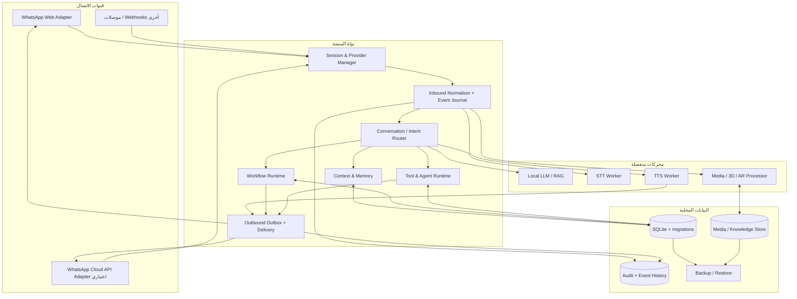

# الخطة الهندسية الرئيسية لبناء Chat BOT — V10

**النسخة المرجعية للمشروع:** v9.20.24  
**تاريخ الخطة:** 31 أكتوبر 2026  
**النمط المستهدف:** Local-first / Self-hosted، مع موصلات سحابية اختيارية وموافقة صريحة  
**الغرض:** تحويل البحث المقارن والمزايا المقترحة إلى برنامج بناء هندسي قابل للتتبع والاختبار. هذا الملف ليس ادعاءً بأن كل المراحل نُفذت؛ إنه عقد التنفيذ والمراجعة الذي تُقاس عليه كل دفعة.

---

## 1. قواعد البناء غير القابلة للتفاوض

1. **البناء قبل الواجهة:** لا تُعتبر الميزة مكتملة لأن لها شاشة أو زرًا. يجب أن يكون لها نموذج بيانات، ومنطق خلفي، وعقود API، وحالات فشل، وتسجيل أحداث، واختبارات فعلية.
2. **لا فقد للوظائف:** أي تعديل يجب أن يثبت عدم كسر السلوك السابق. لا يُحذف أو يستبدل نظام قائم لمجرد أن هناك مكتبة أحدث.
3. **المرجع قبل التنفيذ:** كل ميزة لها مصدر أصلي ورابط وإصدار/تاريخ مراجعة. تُفصل الخصائص الموثقة رسميًا عن خصائص المكتبة غير الرسمية وعن أمثلة مزودي الخدمة وعن أفكارنا المقترحة.
4. **قابلية كشف القدرة:** لا يرسل النظام تفاعلًا لمجرد أن الواجهة تعرضه. يطلب من موصل القناة بيان قدراته وحدوده، ويختار رسالة بديلة آمنة عند عدم الدعم.
5. **التسليم مرة واحدة قدر الإمكان:** كل رسالة أو مهمة لها معرف ثابت ومنع تكرار. عندما تكون نتيجة الإرسال غير مؤكدة، تُحجز للمراجعة ولا تُعاد عشوائيًا.
6. **الفشل المعزول:** تعطل الصوت أو نموذج AI أو خدمة خارجية لا يسقط WhatsApp ولا يوقف استقبال الرسائل.
7. **العمل المحلي أولًا:** SQLite/ملفات محلية ونماذج محلية وأدوات محلية هي الأساس. PostgreSQL/Redis/Cloud APIs خيارات توسعة فقط وليست شرطًا لتشغيل النسخة الفردية.
8. **الخصوصية الافتراضية:** لا تُرسل الرسائل أو التسجيلات أو الملفات إلى مزود خارجي دون اختيار المستخدم وموافقته الواضحة. تحفظ المفاتيح والأسرار خارج السجلات.
9. **اختبار المصدر الحي منفصل عن المحاكاة:** اختبار unit أو mock لا يُسمى اختبار WhatsApp حيًا، ووجود وزن نموذج لا يثبت نجاح inference.
10. **لا نشر مع فشل مانع:** لا تنتقل المرحلة التالية عند وجود فشل معروف في اختبار إلزامي أو ترحيل بيانات غير قابل للرجوع.

## 2. المعمارية المستهدفة

تُبنى المنصة كتطبيق محلي معياري (Modular Monolith) مع عمال منفصلين للعمليات الثقيلة، لا كشبكة خدمات مصغرة غير لازمة لمستخدم واحد. ويُفصل منطق البوت عن مزود WhatsApp وعن محركات AI.

### حدود مسؤولية الوحدات

| الوحدة | مسؤولة عن | ممنوع عليها |
|---|---|---|
| Channel Adapter | البروتوكول والتحويل إلى/من نماذج القناة | اتخاذ قرار الرد أو حفظ منطق العمل التجاري |
| Session Manager | المصادقة ودورة حياة الجلسة والعزل | تنفيذ قواعد العملاء أو المهام |
| Inbound Pipeline | التحقق والتوحيد والترتيب ومنع التكرار | الرد مباشرةً على المستخدم |
| Conversation Core | النية والسياق وتوجيه المهمة | إرسال رسائل دون Outbox |
| Media Pipeline | الفحص والتحويل والتخزين | فتح ملفات عشوائية خارج مجلدات البيانات |
| Outbox | الإرسال والتأكيد وإعادة المحاولة الآمنة | إعادة إرسال نتيجة غير مؤكدة بصورة عمياء |
| Workflow Runtime | تنفيذ تدفقات محددة الإصدار | تنفيذ JavaScript حر يرسله AI |
| Tool Runtime | تنفيذ أدوات مسموحة بعقود وصلاحيات | الوصول إلى النظام كله أو تجاوز الموافقات |
| AI Workers | الاستدلال والتفريغ والتوليد | التحكم المباشر في جلسة WhatsApp |

## 3. طبقات التخزين والرسائل

### 3.1 التخزين المستهدف

- SQLite محلي مع WAL، ومفاتيح خارجية، ومخططات migrations متسلسلة.
- إبقاء الملفات الكبيرة والصوت والنماذج خارج قاعدة البيانات مع تخزين metadata وhash ومسار آمن.
- واجهة Repository تمنع وصول الوحدات إلى SQL/JSON مباشرة.
- دعم PostgreSQL اختياري عندما يحتاج المشروع إلى أكثر من عملية أو أكثر من مستخدم متزامن.
- Redis ليس شرطًا محليًا؛ لا يُضاف إلا إذا أثبت اختبار الضغط أن Queue محلية لا تكفي.
- ترحيل بيانات JSON الحالية تدريجيًا مع التحقق من count وhash وإمكانية الرجوع. لا يتم حذف JSON القديم قبل تأكيد المستخدم/المرحلة النهائية.

### 3.2 جداول المجال المتوقعة

`schema_migrations`, `sessions`, `channel_accounts`, `channel_capabilities`, `contacts`, `conversations`, `conversation_members`, `messages`, `message_media`, `message_reactions`, `polls`, `poll_votes`, `scheduled_events`, `event_rsvps`, `inbound_events`, `outbox_messages`, `delivery_attempts`, `workflow_definitions`, `workflow_versions`, `workflow_runs`, `workflow_steps`, `tasks`, `tool_runs`, `agents`, `knowledge_sources`, `knowledge_chunks`, `voice_profiles`, `media_assets`, `campaigns`, `consents`, `integrations`, `secrets_metadata`, `audit_events`, `backups`.

كل جدول يحتاج: primary key ثابت، session/tenant scope، created/updated timestamps، سياسة حذف/احتفاظ، وفهارس محسوبة وفق استعلامات فعلية.

### 3.3 عقد الرسالة الموحد

كل قناة يجب أن تُحوّل الرسالة إلى نموذج موحد يحوي على الأقل:

- `eventId`, `provider`, `accountId`, `conversationId`, `messageId`, `providerMessageId`
- `senderId`, `senderType`, `fromMe`, `quotedMessageId`
- `kind`: text / image / video / audio / document / sticker / location / contact / poll / event / reaction / order / unknown
- `text`, `caption`, `mimeType`, `sizeBytes`, `mediaAssetId`
- `sentAt`, `receivedAt`, `providerTimestamp`, `ackState`
- `rawProviderType`, `capabilityVersion`, `correlationId`

تُحفظ نسخة خام محدودة ومحمية لأغراض التشخيص عند الحاجة، وتطبق عليها سياسة الاحتفاظ والحذف. لا يُسجل نص رسالة أو رقم هاتف في سجلات التشخيص العامة.

---

# 4. مراحل التنفيذ التفصيلية

كل مرحلة مستقلة لها: مخرجات، ملفات/أنظمة متوقعة، بيانات يحتاجها AI، اختبارات، وبوابة خروج. تُنفذ المراحل بالتتابع؛ لا تُعتبر مكتملة قبل نجاح الاختبارات وكتابة تقرير المراجعة.

## المرحلة 00 — تثبيت خط الأساس وجرد المصدر

**الهدف:** معرفة ما يعمل فعليًا وما هو شكلي أو ناقص قبل تغيير architecture.

**الأعمال:**
- حفظ نسخة المصدر الأصلية والنسخة الحالية وhash لكل ملف.
- تحليل كامل لشجرة المشروع وpackage-lock ونسخ المكتبات والأصول.
- استخراج خريطة استدعاءات API والأحداث بين server.js والوحدات.
- جرد الوظائف الحالية: موصل، خدمة، route، store، UI، tests، workers.
- تصنيف كل وظيفة إلى: مثبتة بالاختبار، موجودة دون اختبار، ناقصة، متعارضة، غير موجودة.
- إعداد Feature Traceability Matrix تربط طلب المستخدم والمصدر والملف والاختبار.
- إعداد سجل مخاطر وترتيب موانع الإصدار.

**المدخلات:** ZIP الأصلي v9.20.20، نسخة v9.20.23/24، جميع changelogs والتقارير السابقة، سجلات التشغيل الحقيقية، قائمة بيئة Windows وNode/Python.

**بوابة الخروج:** تقرير baseline + inventory + backup/restore proof + test baseline. لا تغيير في سلوك الإنتاج في هذه المرحلة.

## المرحلة 01 — سلامة الجلسات ومنع ازدواج العمليات

**الهدف:** ضمان ألا تتداخل نسختان أو عمليتان على LocalAuth أو تتعامل callbacks قديمة مع جلسة جديدة.

**الأعمال:**
- قفل حصري للعملية لكل `sessionId` باستخدام PID Node وPID Chromium.
- اكتشاف القفل اليتيم والتحقق من PID قبل استعادته؛ EPERM يعني أن المالك قد يكون حيًا ولا يجوز إزالة القفل.
- حالات موحدة: `idle`, `starting`, `qr`, `authenticated`, `ready`, `reconnecting`, `disconnected`, `logged_out`, `auth_failure`, `error`, `stopped`.
- معرف generation لكل محاولة؛ كل callbacks/Promises/Timers التابعة للجيل القديم غير صالحة بعد تغير الحالة.
- تصنيف `LOGOUT`/`AUTH_FAILURE` كحاجة لإعادة مصادقة؛ لا auto-reconnect. الانقطاع المؤقت فقط يخضع لمحاولات محدودة.
- إغلاق Chromium والتحقق من تحرير profile قبل أي reconnect.
- أرشفة Profile التالف/المنتهي بدل حذفه عند إعادة الربط. الحذف الكامل فقط عند اختيار unlink صراحةً.
- حفظ حالة المصادقة في البيانات حتى تعيش بعد restart.
- إدارة QR وPairing Code كأسرار مؤقتة لا تظهر في logs.

**الملفات الأساسية:** `src/whatsapp.js`, `src/session-process-lock.js`, `src/store.js`, `src/whatsapp-errors.js`, `server.js`, `public/app.js`.

**البيانات للـAI:** أسباب disconnect الحقيقية، عمر الجلسة، process PIDs، chromium PID، generation ID، حالة lock، مسار auth النسبي، آخر event، نسخة whatsapp-web.js وPuppeteer.

**اختبارات الخروج:** Logout, auth_failure, network timeout, conflict, target closed, browser crash, double start, two Node processes, stale PID lock, failed Browser.close, restart and re-pair, Windows file lock. لا تُحذف بيانات المحادثات في أي حالة.

**حالة التنفيذ الحالية:** بدأ تنفيذ هذا الأساس في v9.20.24: قفل عملية، تصنيف LOGOUT، حفظ إعادة المصادقة وأرشفة ملف LocalAuth. اختبارات المحاكاة المحلية لا تعادل اختبار WhatsApp حيًا؛ تظل دورة الحساب الفعلية ضمن بوابة smoke test.

## المرحلة 02 — Channel Provider Abstraction ومصفوفة القدرات

**الهدف:** فك ارتباط منطق البوت بـ`whatsapp-web.js`.

**الأعمال:**
- تعريف `ChannelProvider` interface: connect, disconnect, getStatus, sendText, sendMedia, sendPoll, sendEvent, sendReaction, getCapabilities, normalizeInbound, validateTarget.
- Adapter لـWhatsApp Web الحالي.
- Adapter اختياري لـWhatsApp Cloud API الرسمي.
- Capability registry بخصائص: available, unavailable, experimental, account-restricted, deprecated، مع reason وtestedAt وproviderVersion.
- إعدادات حسب القناة والحساب والمحادثة؛ لا نخلط capabilities للمجموعة مع الفردية أو status/channel.
- لا تعتمد على Buttons/Lists القديمة في whatsapp-web.js لأنها Deprecated. استخدام نص منسق/fallback أو Cloud API interactive عند توفره.

**البيانات:** provider id، إصدار adapter، WABA/number identity عند اختيار Cloud API، صلاحيات الحساب، chat type، customer service window، template status، supported media.

**الاختبارات:** Contract tests موحدة لكل Adapter، capability mismatch، timeout، provider offline، عدم دعم feature، fallback صحيح.

## المرحلة 03 — Inbound Event Pipeline دائم

**الهدف:** تحويل استقبال الرسائل إلى خط معالجة منظم وقابل للاستئناف.

**الأعمال:**
- استقبال Raw event وتوقيع/تحقق Webhook للـCloud API.
- إنشاء eventId/idempotency key.
- حفظ الحدث قبل إحالته للمعالجة.
- تطبيع النص والوسائط والتفاعلات والاستطلاعات والأحداث والطلبات.
- FIFO per conversation مع parallelism بين المحادثات.
- كشف التكرار والرسائل القديمة وحالات replay.
- quarantine للحدث غير المفهوم دون إسقاط طابور كامل.
- dead-letter queue مع retry policy وreplay tooling.
- إرفاق correlationId من القناة حتى رد AI والإرسال.

**البيانات:** provider IDs، timestamps، message IDs، chat IDs، raw event type، media metadata، receive order.

**الاختبارات:** duplicate delivery، out-of-order، malformed event، worker crash mid-processing، resume after restart، high volume، one conversation slow must not block others.

## المرحلة 04 — Outbound Outbox وموثوقية التسليم

**الهدف:** فصل قرار الإرسال عن تنفيذ القناة وضمان منع التكرار.

**الأعمال:**
- Outbox دائم؛ كل طلب إرسال يتحول إلى record قبل التنفيذ.
- statuses: queued, validating, sending, accepted, created, delivered, read, failed, uncertain, cancelled, dead-letter.
- `idempotencyKey` لكل الرسالة.
- queue per conversation مع rate limiting / typing indicators / pacing.
- retries فقط للفشل المؤكد أنه لم يُرسل. `SEND_UNCERTAIN` لا يعاد تلقائيًا.
- reconciliation من ACKs وmessage events.
- cancellation، dedupe window، partial failure handling، manual retry.
- إرسال الرسائل النصية وملفات الوسائط والاستطلاعات والأحداث عبر executor موحد.

**البيانات:** target، payload ref، provider key، attempt count، ack state، send intent، result timestamps، retry policy.

**الاختبارات:** timeout قبل provider acceptance، timeout بعد قبول provider، duplicate event، ACK متأخر، worker kill، rate limit، partial media batch.

## المرحلة 05 — Media Asset Pipeline

**الهدف:** إدارة الأصول والملفات كمنظومة منفصلة ومحمية.

**الأعمال:**
- staging directory + asset ID/hash + content sniffing.
- MIME check مع امتداد الملف؛ لا تثق بامتداده فقط.
- قيود الحجم والمدة والأبعاد لكل قناة.
- فحص ملفات ضارة اختياري عبر ClamAV أو scanner محلي.
- thumbnails وpreview وmetadata extraction.
- FFmpeg للتحويل والفصل الصوتي واستخراج keyframes وتقليل الفيديو.
- صور: metadata strip، thumbnails، OCR حسب السياسة.
- صوت: loudness، codec، duration، waveform، normalization.
- مستندات: PDF/Office/text/CSV parsers مع source page/row metadata.
- dedup عبر SHA-256، retention وcleanup؛ منع path traversal.
- streaming/limits لتجنب تحميل ملفات كبيرة كاملة إلى RAM.

**البيانات:** source path، asset hash، mime، size، duration، dimensions، scanned status، derived assets، retention.

**الاختبارات:** MIME spoof، zero-byte، corrupted, oversized, decompression bomb, path traversal, duplicate, interrupted conversion, cleanup failure.

## المرحلة 06 — تفاعلات WhatsApp الأصلية

**الهدف:** إضافة وظائف أصلية فعلية للمحادثات من خلال adapters مع قدرة وتوافق موثقين.

**المزايا:**
- Polls: إنشاء poll، خيارات حتى الحدود التي تفرضها قناة WhatsApp، single/multiple choice، متابعة vote_update، استرجاع أصوات التصويت، تجميع النتائج.
- Scheduled Events: اسم ووصف ووقت بداية/نهاية ومكان ونوع مكالمة، تعديل/إلغاء، ردود Going/Not Going/Maybe، تذكيرات داخلية ورسائل متابعة.
- Reactions: إضافة/تغيير/حذف reaction وتسجيل صاحبها والرسالة المستهدفة.
- Stickers: التحويل إلى WebP والتحقق من حد static/animated وفق القناة.
- Locations وContact Cards وvoice notes والردود المقتبسة.
- قنوات/مجتمعات عندما تثبت المكتبة/الحساب القدرة فقط.
- Polls على WhatsApp Web تبدأ في المجموعات كمسار مثبت بالوثائق؛ دعم 1:1 لا يُفعل قبل اختبار حي. الأحداث تُختبر في الفردي والمجموعة لأن سلوك المنتج قد يختلف بالإصدار.
- لا تستخدم Buttons/Lists deprecated في whatsapp-web.js؛ fallback هو رسالة نصية بخيارات مرقمة مع correlation ID وانتهاء مهلة.

**البيانات:** pollId/messageId، options، voter، selectedOptions، vote time، eventId، start/end UTC، timezone، RSVP state، location، reminder state.

**الاختبارات:** group poll, multi/single choice, vote update/dedupe, poll vote reconciliation, event creation and RSVPs, event edit/cancel, chat type gates, unsupported capability fallback.

## المرحلة 07 — WhatsApp Cloud API وInteractive Business Messaging

**الهدف:** إضافة ميزات Business API المتقدمة كموصل مستقل، دون إيهام مستخدم WhatsApp Web بأنه يملكها.

**المزايا:**
- Interactive reply buttons (حتى 3 في أنواع محددة) وlist messages.
- CTA URL / call-to-action buttons.
- WhatsApp Flows: forms متعددة الشاشات، حقول نصية، اختيار فردي ومتعدد، تاريخ، toggles، إرسال/استقبال data exchange من backend.
- Product messages وcatalog وproduct lists/cart حيث تكون Commerce Manager/WABA مرتبطة ومؤهلة.
- Carousels ضمن القوالب/أنواع الإرسال المتاحة من Meta/BSP وبعدد البطاقات والأنواع المسموحة.
- template approval state، customer service window، template category، opt-in/opt-out، webhook status.
- لا يُرسل Flow أو Carousel أو Catalog إلا إذا كان الحساب والموصل والبلد والقالب مؤهلًا والقدرة مكتشفة.
- لا تُخلط إمكانيات BSP مع API الأساسي دون ذكر أن BSP قد يوفر layer إضافية.

**البيانات:** WABA ID/phone number ID، template name/language/status, Flow ID/JSON version, catalog ID, product IDs, service-window state, consent.

**الاختبارات:** invalid template, unapproved template, out-of-window, missing catalog, unavailable Flow, webhook verification, signature invalid, retry policy, opt-out suppression.

## المرحلة 08 — محتوى 3D/AR ووسائط تفاعلية خارج فقاعات WhatsApp

**الهدف:** منح المستخدم تجربة عرض نموذج ثلاثي الأبعاد/واقع معزز دون الادعاء أن WhatsApp يدعم عارض 3D تفاعليًا داخل فقاعة المحادثة.

**الأعمال:**
- upload/validate GLB/GLTF/USDZ، تحليل الحجم والـtextures، فحص ملفات zip/embedded scripts.
- توليد thumbnail وposter وصورة preview وفيديو spin قصير تلقائيًا.
- إنشاء صفحة WebAR آمنة بعارض مثل `<model-viewer>` أو viewer محلي مع fallback 3D فقط.
- رابط مؤقت signed token/expiry/revoke، HTTPS، منع directory traversal، منع عرض محتوى HTML/JS غير موثوق من الملف.
- دعم Android Scene Viewer وiOS Quick Look حيث يتوفر المتصفح والجهاز؛ وإلا يظهر عارض ويب ثلاثي الأبعاد عادي.
- إرسال صورة/فيديو preview في WhatsApp مع CTA URL إلى عارض 3D؛ يمكن إرسال الملف كمستند فقط إذا دعمته القناة وحجم الملف ضمن الحدود.
- QR للمشاركة/فتح الصفحة، analytics local optional، لا tracking خارجي افتراضيًا.
- تجارب منتجات، قطع غيار، أثاث، مجسمات تعليمية، كتالوجات تفاعلية.

**البيانات:** model hash, format, bounds, materials, textures, size, safety scan, preview refs, public share token hash, expiry, access count.

**الاختبارات:** invalid GLB, malformed glTF, oversized textures, expired token, revoked token, cross-session access denied, iOS/Android/browser fallback, no embedded script execution.

## المرحلة 09 — Conversation Core وModel Routing

**الهدف:** فصل توليد المعنى عن قناة الاتصال والصوت.

**الأعمال:**
- language/dialect detection and normalization.
- intent classification، entities، slots، confidence calibration.
- conversation planner مع state machine لكل حوار.
- اختيار model حسب المهمة (intent/summary/RAG/tool/voice transcript) وحسب قدرات الجهاز.
- prompt registry وversioning وtest cases.
- response validators لمنع claims غير المسندة/إعادة كلمات حساسة.
- fallback deterministic إذا LLM غير متوفر.
- لا ينفذ النموذج أي شيء؛ يطلب Tool فقط عبر Tool Runtime.

**البيانات:** utterance، language، intent، entities، confidence، conversation state، model id/version، prompt version، latency/token usage.

**الاختبارات:** dialect mix، ambiguous request، prompt injection، hallucination checks، model offline، context mismatch، safe fallback.

## المرحلة 10 — Memory & Conversation Context

**الهدف:** ذاكرة عملية محكومة بالخصوصية، وليس تكديس كل الرسائل داخل prompt.

**الأعمال:**
- short-term context window، rolling summary، long-term facts، task memory.
- memory provenance: من قالها؟ متى؟ هل المستخدم وافق؟ expiry؟
- user correction/deletion/forget، retention policy.
- per-contact/per-conversation isolation.
- relevance retrieval مع freshness.
- منع حفظ بيانات حساسة افتراضيًا أو إرسالها إلى أي نموذج سحابي دون موافقة.

**البيانات:** fact, source message ID, confidence, createdAt, expiry, consent, correction status, scope.

**الاختبارات:** cross-chat isolation, expired memory, correction supersedes old fact, deletion propagation, no unsupported fact in response.

## المرحلة 11 — Knowledge Base وRAG Ingestion

**الهدف:** الإجابة من مصادر المستخدم بدل اختلاق المعلومات.

**الأعمال:**
- ingestion PDF/Word/Excel/CSV/HTML/Markdown/image OCR/audio transcript.
- parse tables and section headings, page/row provenance.
- chunk with semantic boundaries, embeddings local, full-text fallback.
- incremental reindex, delete, stale-source detection.
- vector/FTS retrieval hybrid; citations in generated responses.
- trust zones: verified docs vs user uploads vs websites.
- no evidence -> say unknown / ask follow-up.

**البيانات:** source ID, version, checksum, page/section, chunk ID, text, embedding model, index timestamp, permissions.

**الاختبارات:** duplicate docs, changed source, delete source, table row lookup, conflicting docs, stale info, retrieval precision/recall benchmark.

## المرحلة 12 — Voice Platform: STT, TTS, Prosody, Dialogue

**الهدف:** بناء صوت end-to-end قابل للقياس، وليس مجرد ملف صوتي بعد كل رد.

**الأعمال:**
- incoming pipeline: codec validate -> VAD -> STT -> language/dialect -> transcript quality -> conversation state.
- local-first STT with model registry and hardware capability detection.
- TTS model registry with Audar, Chatterbox, Piper and tested alternatives; licenses/weight revisions pinned.
- speaker/voice profile, consent and ownership record, reference audio validation.
- emotional/prosody plan independent of text content; tags only where supported.
- chunk synthesis with overlap/crossfade, loudness normalization, silence limits, audio QA.
- OGG/Opus for voice-note delivery; audio-as-file distinct.
- pronunciation dictionary and per-language normalization, dates/currencies/numbers/acronyms.
- evaluation dataset: Arabic Fusha/Egyptian/Gulf/Levantine/English/French/German etc; WER/CER plus blinded human ratings naturalness/pronunciation/expression.
- CPU/GPU profiling, memory budget, cold-start/load time, worker supervision.

**البيانات:** transcript, confidence segments, language, dialect, STT model, text response, voice ID, emotion plan, TTS model+revision, waveform metrics, human QA score.

**الاختبارات:** noisy voice, short/long audio, language switching, names/numbers, mixed Arabic-English, emotional differences, clip corruption, worker crash, voice-note upload and live playback.

## المرحلة 13 — Tool Runtime وAgent Orchestration

**الهدف:** تحويل AI إلى مساعد ينفذ أدوات مع صلاحيات وموافقات.

**الأعمال:**
- Tool registry with JSON schemas, input/output validation.
- allowlist, per-tool permissions, approvals for sending/deleting/financial or external actions.
- sandboxed worker (no arbitrary shell or file paths).
- deadline/cancellation, rate limits, concurrency caps.
- long-running task state machine with checkpoints, resume and compensation actions.
- agents: support/sales/files/voice/booking/admin, each with scoped knowledge/tools.
- human handoff and escalation.
- audit every tool input/output with secrets redacted.

**البيانات:** tool ID/version/schema, caller agent, user approval, sanitized args, task state, checkpoint, result, cost/latency.

**الاختبارات:** invalid args, unauthorized tool, prompt injection, task crash/resume, duplicate tool call, cancellation, compensating action.

## المرحلة 14 — Workflow Runtime (Backend قبل محرر السحب والإفلات)

**الهدف:** محرك DAG/versioned workflow deterministic.

**الأعمال:**
- nodes typed: trigger, condition, branch, wait, delay, send, media, AI, knowledge, tool, webhook, event, poll, CRM, end.
- edges typed and schema validated.
- immutable version snapshots; drafts vs active version.
- run state and per-node state; checkpointing; timer wheel/scheduler.
- idempotency at every side-effect node.
- retry/backoff/dead-letter and compensations.
- per-conversation concurrency/lock and maximum steps/depth/loop prevention.
- simulation using captured event fixtures; replay without sending externally.

**البيانات:** workflow ID/version, node config, typed edges, variables, run ID, node execution, retry, result, correlation ID.

**الاختبارات:** cycles rejected/guarded, invalid branch, timer after restart, no double-send, run version immutability, concurrency race, dead-letter replay.

## المرحلة 15 — CRM & Inbox Domain Backend

**الهدف:** إدارة علاقات العملاء والمحادثات بطريقة قابلة للتوسع.

**الأعمال:**
- contact identity mapping and dedupe (phone/JID/LID/provider IDs).
- customer profile, tags, notes, custom fields, tasks, assignments, SLA.
- conversation ownership/queues/status/priority.
- internal notes separate from outbound messages.
- conversation history archive/replay/export.
- contact merge with audit and conflict resolution.
- data export/delete requests.

**البيانات:** contact IDs, verified identity mappings, tags, assignments, SLA events, notes, tasks, archive pointers.

**الاختبارات:** LID/PN mapping conflict, contact merge, inactive contact, deleted contact, assignment race, archive restoration, permission scope.

## المرحلة 16 — Campaigns, Scheduling, Events, Notifications

**الهدف:** إدارة حملات ومواعيد منضبطة بسياسات القناة.

**الأعمال:**
- segmentation, opt-in/opt-out, frequency caps, quiet hours, suppression lists.
- message templates and approvals in Cloud API path.
- scheduled jobs durable across restart, timezone-safe recurrence, DST handling.
- event reminders and RSVP follow-up.
- campaign batching, idempotency, delivery reports, partial pause/stop.
- avoid unsolicited bulk messaging; implement consent checks and policy gates.

**البيانات:** consent source/time, audience query snapshot, campaign version, schedule timezone, delivery state, opt-out event.

**الاختبارات:** opt-out suppression, duplicate audience, DST, app restart at due time, account rate limit, approved/unapproved template, stop mid-batch.

## المرحلة 17 — Integrations & Plugin Platform

**الهدف:** تكامل آمن وقابل للاختبار دون ربط النظام بتطبيق خارجي واحد.

**الأعمال:**
- plugin manifest, capability and permission declarations.
- connectors for Google Sheets, SMTP/email, Calendar, SQLite/Postgres, HTTP/OpenAPI, n8n/Webhooks, e-commerce adapters.
- secrets vault encrypted at rest, OAuth where appropriate, token rotation.
- timeouts, retries, circuit breaker, rate limits, idempotency.
- webhook signature verification, replay attack defense.
- test harness and sandboxed connector execution.

**البيانات:** plugin ID/version, scopes, credential reference, schema, health, quota, webhook event ID.

**الاختبارات:** expired token, rotated key, invalid signature, slow API, rate limit, schema drift, connector disabled, secret redaction.

## المرحلة 18 — Security, Privacy, Permissions & Data Governance

**الهدف:** حماية محلية ومركزية للعمليات والبيانات.

**الأعمال:**
- RBAC: owner/admin/supervisor/agent/read-only.
- per-session and per-conversation scopes.
- encryption for credentials and sensitive stored data.
- local vault and OS permissions; secrets never in `.env` sample or logs.
- audit events immutable append-only where feasible.
- retention/export/delete policies, consent records.
- safe file roots, MIME sniffing, scanner, upload limits.
- backup encryption and integrity checks.
- AI prompt-injection/data-exfiltration defenses.

**البيانات:** role, permission, actor, resource, action, approval, audit hash, retention policy.

**الاختبارات:** IDOR, cross-session data, unauthorized tool, path traversal, secret leak, backup tamper, delete propagation.

## المرحلة 19 — Observability, Diagnostics, Performance & Recovery

**الهدف:** معرفة ما يحدث داخليًا دون تسريب محتوى العملاء.

**الأعمال:**
- structured logs with correlation IDs.
- metrics: queue depth/latency, send ack, inbound delays, DB latency, model load/inference, memory/CPU/disk.
- traces for message lifecycle.
- health/readiness/liveness endpoints.
- alert thresholds and action hints.
- resource guardrails, worker restart policy, circuit breakers.
- backup schedules, restore drills, migration verification.
- support bundle with redaction and environment summary.

**البيانات:** event counts, durations, error codes, version, resource use, provider state; no raw message contents by default.

**الاختبارات:** disk full, DB locked, worker OOM, queue saturation, app restart, backup restore, log redaction.

## المرحلة 20 — Admin UI Integration (بعد ثبات الخدمات)

**الهدف:** عرض وظائف حقيقية من الـbackend دون mock screens.

**الشاشات:**
- Dashboard live health/queue/failure/traffic.
- Inbox and CRM.
- Flow editor connected to versioned runtime.
- Agent/tool registry and permissions.
- Knowledge source manager and ingestion status.
- Voice studio with real model state, samples and QA.
- WhatsApp native interaction builder for polls/events/reactions.
- Cloud API Flows/templates/catalog capability status.
- 3D asset library, preview, share link and AR viewer preview.
- integrations/plugins, backup, audit, settings.
- localized Arabic-first UI, accessible keyboard support, dark/light themes.

**اختبارات:** every button/API mapping, empty/loading/error states, stale optimistic UI, concurrency conflicts, responsive, Arabic RTL, permission-based rendering.

## المرحلة 21 — Test Harness, Chaos, Regression & Live Certification

**الهدف:** إثبات التكامل عبر كل الأنظمة.

**الأعمال:**
- unit + integration + contract + browser E2E.
- local simulator for WhatsApp events and media.
- live smoke suite with dedicated test account (manual approval; never auto-send to real customers).
- chaos tests for disconnect, process kill, corrupted file, network loss, queue congestion.
- golden dataset for text/voice/knowledge/workflows.
- CI version pinning and artifact hashes.
- regression matrix vs previous release.

**بوابة الخروج:** لا أخطاء إلزامية فاشلة. كل test skip مذكور بالاسم والسبب. كل live test يوسم live وليس mock.

## المرحلة 22 — Packaging, Migration, Release & Operations Manual

**الهدف:** تسليم نسخة كاملة قابلة للتثبيت والترقية والرجوع.

**الأعمال:**
- installer/launcher checks for Windows first, then Linux/macOS.
- Node/Python/browser dependency bootstrap.
- model download manager with resumable download/checksum/license/space check and manual placement fallback.
- migration wizard and pre-upgrade backup.
- rollback procedure and database snapshot validation.
- sanitized `.env.example`, licenses and notices.
- complete Arabic docs, troubleshooting, architecture, capability matrix, changelog, test report.
- package ZIP clean of node_modules/data/auth/models/private keys, unless user explicitly asks for a full offline bundle and weights licensing permits it.

**بوابة الخروج:** clean extraction + install test + start/stop + backup/restore + migration + checksum + no secrets in artifact.

---

# 5. تفاعلات WhatsApp والوسائط: ما هو ممكن فعليًا؟

## 5.1 قناة WhatsApp Web (`whatsapp-web.js`)

المكتبة المثبتة بالمشروع 1.34.7 توثق إرسال/استقبال النص والوسائط، الملصقات، جهات الاتصال، المواقع، الردود، التفاعلات، الاستطلاعات والتصويت، والقنوات. توثق أن أزرار الرسائل والقوائم Deprecated، ومكتباتها تعتمد على بنية WhatsApp Web الداخلية وPuppeteer. لذلك:

- Polls وScheduled Events وvotes/reactions تُستخدم خلف feature flags واختبارات إصدار، وليست واجهة مضمونة على كل أنواع المحادثات.
- Polls تبدأ بالمجموعات لأن دليل WhatsApp الرسمي يشرحها كاستطلاعات للمجموعات؛ لا يُفتح مسار DM قبل اختبار حي.
- Scheduled Events تدعم بيانات الحدث وRSVP وفق ما توثقه المنصة/المكتبة؛ يلزم اختبار فعلي على الحساب والنسخة المستهدفة.
- لا نبني أي شيء جديد على Buttons/Lists القديمة في whatsapp-web.js.
- هذه المكتبة غير رسمية؛ استخدامها قد يحمل مخاطر توافق/حظر حساب ولا تضمن Meta استقرارها.

## 5.2 WhatsApp Cloud API / BSP

مسار مختلف تمامًا: يحتاج WABA ورقمًا مؤهلًا وtokens وwebhooks وقوالب معتمدة حيث يلزم. يمكن أن يوفر Interactive buttons/lists/CTA وFlows وProduct/Catalog/Cart وCarousels بحسب نوع الرسالة والقالب والنافذة والسياسات. لا تنقل هذه القدرات إلى موصل WebJS تلقائيًا. بعض ميزات المجموعات وميزات التجارة لها شروط أهلية وقيود خاصة بالمزود والحساب؛ القدرة يجب أن تكون من API docs للـendpoint الفعلي وليست افتراضًا عامًا.

## 5.3 صور ونماذج ثلاثية الأبعاد

WhatsApp يرسل صورة أو فيديو preview أو مستندًا. التجربة المناسبة لمجسم 3D هي: preview داخل المحادثة -> رابط قصير آمن -> صفحة عارض WebAR -> fallback إلى 3D browser viewer أو ملف تنزيل. يجب عدم تشغيل scripts من GLTF أو الملفات المحملة. لا ندعي أن النموذج 3D قابل للدوران داخل فقاعة WhatsApp نفسها.

## 5.4 فعاليات وألعاب داخل المحادثة

- حدث WhatsApp مجدول مع RSVPs وتذكير آلي.
- Poll أصلي للمجموعة مع قراءة التصويت والنتائج.
- Quiz عبر Poll أو تدفق محادثة نصي/Flow، مع تسجيل الإجابة والدرجة.
- اختيار منتج/موعد من WhatsApp Flow أو Catalog عندما تكون القناة Cloud API مؤهلة؛ في WebJS استخدم text-choice fallback مع session token وانتهاء صلاحية.
- تفاعل 3D: image/video card + deep link آمن إلى WebAR.
- Sticker packs, reaction triggers, voice tasks، QR links، share cards.

---

# 6. مصدر البحث وربط الميزة به

المصادر التالية هي أساس القدرة، وليست دليلًا على أن كل feature متاحة لكل موصل أو حساب. يجب تثبيت تاريخ مراجعة المصدر وإصدار المكتبة في اختبارات المشروع.

| المصدر | ما يستند إليه | المراحل |
|---|---|---|
| https://docs.wwebjs.dev/ | قدرات whatsapp-web.js 1.34.7، Poll, reactions, media, deprecations | 01–06 |
| https://docs.wwebjs.dev/Client.html | أحداث العميل، vote_update، الرد على Scheduled Event، sendMessage | 02–06 |
| https://docs.wwebjs.dev/ScheduledEvent.html | بنية الحدث وحقوله | 06, 16 |
| https://faq.whatsapp.com/796470361614974/ | استطلاعات WhatsApp والحدود المذكورة من مركز المساعدة | 06 |
| https://faq.whatsapp.com/ | مركز مساعدة WhatsApp للفعاليات والمجموعات والسياسات | 06, 16 |
| https://developers.facebook.com/docs/whatsapp/cloud-api/ | Cloud API الرسمية والرسائل والـwebhooks والقوالب | 02, 07, 16 |
| https://developers.facebook.com/docs/whatsapp/flows/ | WhatsApp Flows | 07 |
| https://docs.360dialog.com/partner/waba-management/whatsapp-flows | أمثلة تدفق تفاعلي عبر BSP؛ ليست بديلًا لتوثيق Meta | 07 |
| https://www.twilio.com/docs/whatsapp/flows | إدارة وإرسال Flows من مزود BSP | 07 |
| https://docs.aws.amazon.com/social-messaging/latest/userguide/supported-media-types.html | قيود أنواع وأحجام وسائط Cloud API | 05, 07 |
| https://developers.google.com/ar/develop/scene-viewer | فتح عارض AR على أجهزة Android | 08 |
| https://modelviewer.dev/ | Web component لعرض glTF/GLB وAR حيث يدعم الجهاز | 08 |
| https://github.com/wwebjs/whatsapp-web.js/issues/5776 | بلاغ detached Frame في المكتبة؛ يحتاج تحقق من الحالة الحالية | 01, 21 |
| https://github.com/devlikeapro/waha/issues/2222 | مثال حديث لتداخل listener injection ثم detached Frame/LOGOUT على WebJS wrapper؛ لا يثبت أن كل الحالات سببها نفسه | 01, 21 |

---

# 7. Feature Traceability Matrix — العناصر التي لا يجوز أن تسقط من خطة البناء

| البحث/طلب المنتج | المرحلة | المكوّن/عقد البيانات | إثبات القبول |
|---|---:|---|---|
| اتصال QR/Phone/LocalAuth ثابت | 01–02 | Session Manager + process lock | logout/reconnect/double-process tests |
| الرسائل والردود والاقتباس | 03–04 | Message normalized + Outbox | duplicate/uncertain ACK/e2e |
| صور/فيديو/ملفات/صوت/ملصقات | 05 | MediaAsset pipeline | corrupted/size/MIME/live send |
| استطلاعات وتصويت | 06 | Poll / PollVote / vote_update | create/vote/get-votes/live group |
| أحداث ومواعيد وRSVP | 06,16 | ScheduledEvent/EventRSVP | create/edit/cancel/respond/remind |
| Reactions وLocations وContacts | 06 | Reaction/Location/Contact | inbound/outbound contract |
| Buttons/Lists الحديثة | 07 أو fallback | capability registry | Cloud API/Template test; no deprecated WebJS |
| WhatsApp Flows forms | 07 | Flow schema/version/webhook | submit/validate/backend exchange |
| Catalog/Products/Cart | 07 | Product/Order webhook | catalog eligibility/order event |
| Carousel | 07 | Carousel Template | template approval/card constraints |
| 3D/AR | 08 | ModelAsset/ShareToken | viewer and expiry/security tests |
| AI conversation/intent/entities | 09 | ConversationState | benchmark + prompt injection |
| Memory | 10 | MemoryFact/provenance | isolation/delete/expiry |
| Knowledge/RAG | 11 | Source/Chunk/Index | retrieval benchmark/citations |
| Voice/STT/TTS/emotion/pronunciation | 12 | VoiceJob/VoiceProfile | real audio evaluation/live playback |
| AI tools/agents | 13 | ToolCall/Task/Approval | permission/injection/resume |
| Workflow engine & visual builder | 14,20 | DAG/Version/Run/Node | simulation/replay/no-double-send |
| CRM/Inbox | 15,20 | Contact/Conversation/Assignment | identity/permissions/history |
| Campaign/scheduler/consent | 16 | Campaign/Consent/Delivery | opt-out/timezone/rate cap |
| Plugins/Integrations/n8n | 17 | PluginManifest/Connector | schema/security/timeout |
| RBAC/Audit/backup/restore | 18–19 | Role/Audit/Backup | unauthorized access/restore drill |
| Dashboard/analytics/voice studio/3D gallery | 20 | typed APIs, no mock data | end-to-end UI integration |
| multilingual, search, import/export, notifications, shortcuts, themes | 18–20 | preferences/index/export/event | locale/accessibility/regression |

---

# 8. معيار اكتمال المرحلة

لا تُغلق المرحلة حتى تتوفر جميع الأدلة:

1. Code review للتغييرات، ومقارنة tree قبل/بعد.
2. اختبارات وحدة وتكامل وعقود للموصلات المتأثرة.
3. اختبارات انحدار على كل وظيفة سابقة مرتبطة.
4. اختبار فشل/timeout/Restart/cleanup.
5. ترحيل قاعدة البيانات ينجح على نسخة بيانات قديمة مستنسخة.
6. لا secrets أو session auth أو customer media في ZIP النهائي.
7. تحديث architecture وdata contracts وchangelog وrelease notes.
8. تقرير يذكر pass/failed/skipped مع سبب skip بالاسم.
9. اختبار live عند الحاجة وموسوم بوضوح؛ وإلا يذكر صراحةً أنه غير منفذ.
10. حزمة كاملة قابلة للاستخراج وSHA-256 وفحص ملفات الأرشيف.

**لا يوجد ضمان مطلق لخلو أي برنامج من كل الأخطاء**، لكن لا يسلّم إصدار عند وجود فشل معروف يمنع التشغيل أو يكسر البيانات أو يخالف معيار قبول إلزاميًا. وتبقى قيود WhatsApp ومزودي الخدمة والأجهزة الخارجية بحاجة إلى اختبار حي على الحساب/الجهاز المستهدف.
